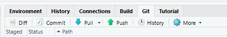

These are basic instructions on how to update these pages.

## To begin

Make a local copy of the Github

Choose **New Project** and select the option **version control** then **Git** and add the URL of the repo *https://github.com/nhsengland/SW_ways_of_working* and choose a local folder to save your version.

## The structure

### YAML

The YAML is the main file that deals with the overall layout.  There should be no major reason to adjust the YAML.  Perhaps if you are adding a new page or section.

### .qmd Files

These are the raw pages of code that generate the pages.  

Formatting these files can be done via 'Visual' tab on the main code pane, standard markdown formatting [Cheat sheet](https://www.markdownguide.org/cheat-sheet/) or via HTML tags.

It is possible to include R and python code within these pages to build charts and tables.  

## To update a page    

Ensure you have the latest version of the pages that match those on Github.

Click on **Git** tab in R studio



To do this click **Pull**

::: {.callout-tip appearance="default" icon="true"}
If this your first time connecting, it may ask for username and password.  This may open in a new window, which sometimes sits behind other programs, please check your task bar.
:::

This will update your local files and sync them to the master on Github

Update your local version of the .qmd file and save

Click on **Git** tab in R studio

Click on staged file you wish to update.  

Click **Push** update page to git

This process updates the underlying qmd files

You will then need to update the rendered HTML pages

Yo do click click on the **Terminal** and type

quarto publish gh-pages

```{mermaid}
flowchart LR
A[Pull] --> B[Update .qmd]
B --> C[Commit]
C --> D[Push]

```


